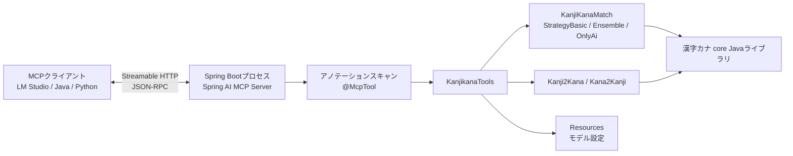
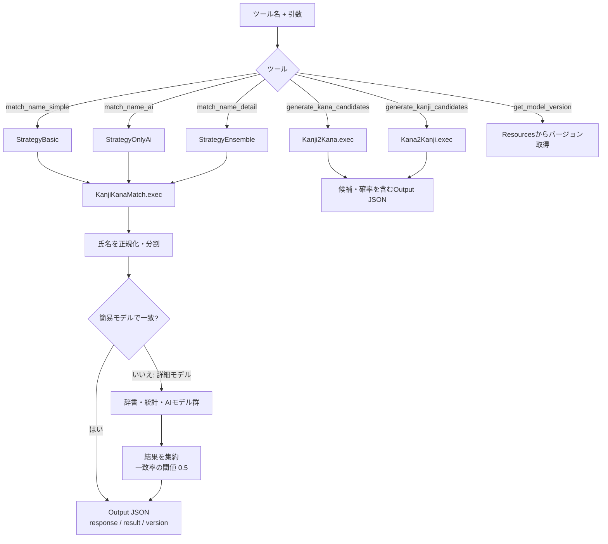

# 漢字カナ MCP Server (Spring AI)

Spring AI MCP Server Boot Starterで実装したStreamable HTTP形式のMCPサーバです。漢字カナモデルのコアJavaソースを直接呼び出し、Docker REST APIへのHTTP呼び出しは行いません。

## 構成

Spring BootがHTTPサーバを起動し、MCPクライアントと `/mcp` エンドポイントでMCPメッセージを交換します。サーバ側ではSpring AIが `@McpTool` を検出してツールとして登録し、各ツールは既存の `core` Javaクラスに処理を委譲します。



既定では `127.0.0.1:8080` のみで待ち受け、MCPエンドポイントは `http://localhost:8080/mcp` です。HTTP transportは認証なしでツールを公開するため、外部ネットワークへ公開する場合は認証・アクセス制御を別途設定してください。

## ツール処理の流れ

クライアントはツール名と引数を送ります。照合ツールは指定された戦略で `KanjiKanaMatch` を呼び出し、候補生成ツールは対応する生成クラスを呼び出します。結果はMCPのテキストコンテンツとして返します。



`match_name_detail` はまず簡易モデルで判定し、不一致の場合に辞書・統計・AIモデル群の判定結果を集約します。`match_name_simple` と `match_name_ai` はそれぞれ簡易モデルとAIモデルのみを使います。詳細モデルが返す `result.status` は一致度（0〜99）です。

## ビルド

JDK 17以上とMaven 3が必要です。リポジトリのルートディレクトリで実行します。

```sh
mvn -f mcp-server/pom.xml package -DskipTests
```

このビルドは `core/lib/kanjikana_core-2.0o-20260929-jar-with-dependencies.jar` を直接参照します。coreのソース再ビルドは行わず、`dict_2.0o.dat` を含む辞書・モデル資産もこのJARから読み込みます。`api/lib/kanjikana_api-2.0o-20260929-jar-with-dependencies.jar` はREST APIの実装を含むため、RESTを経由しないこのMCPサーバでは使用しません。`-DskipTests` は、別途存在する `core` のテスト失敗（資産に依存するテストと `OutputMakerTest` の期待値不一致）を避けてMCPサーバをパッケージするための指定です。初回実行時、DJLが必要なエンジンをダウンロードするためインターネット接続が必要な場合があります。

## 起動

```sh
java -jar mcp-server/server/target/kanjikana-mcp-server-1.0.0.jar
```

起動後、MCPクライアントから `http://localhost:8080/mcp` に接続します。既定の待受先はlocalhostです。LANなど別ホストから接続する場合は `server.address` を `0.0.0.0` に変更できますが、その前にファイアウォールや認証などでアクセスを制限してください。

## LM Studio

LM Studioの **Program > Install > Edit mcp.json** を開き、`mcpServers` に次の設定を追加します。

```json
{
	"mcpServers": {
		"kanjikana": {
			"url": "http://localhost:8080/mcp"
		}
	}
}
```

先に上記の手順でMCPサーバを起動し、LM Studioのチャットで `kanjikana` のツールを有効にしてください。

## 提供ツール

- `match_name_detail`: 詳細モデルによる氏名照合
- `match_name_simple`: 簡易モデルによる氏名照合
- `match_name_ai`: AIモデルによる氏名照合
- `generate_kana_candidates`: 漢字氏名からカナ候補を生成（`max`: 1-10）
- `generate_kanji_candidates`: カナ氏名から漢字候補を生成（`max`: 1-10）
- `get_model_version`: コアモデルのバージョンを取得

Spring AIのバージョンは2.0.0、Spring Bootのバージョンは4.0.0です。ツールは `@McpTool` アノテーションで登録されます。

照合ツールは `kanji` と `kana` を受け取り、任意の `debug: true` で判定メモも返します。

## VS Code

VS CodeのMCP設定に `http://localhost:8080/mcp` を登録し、先にMCPサーバを起動してください。

## Javaクライアントサンプル

`client-sample/` にSpring AI MCPクライアントの実行例があります。まず別のターミナルでサーバを起動し、その後リポジトリルートでクライアントを起動します。

```sh
mvn -f mcp-server/pom.xml package -DskipTests
```

サーバを起動します。

```sh
java -jar mcp-server/server/target/kanjikana-mcp-server-1.0.0.jar
```

別のターミナルでクライアントを実行します。

```sh
mvn -f mcp-server/client-sample/pom.xml spring-boot:run
```

クライアントはHTTPで接続し、ツール一覧を取得して `match_name_simple` を呼び出します。実装は [KanjikanaClientSample.java](client-sample/src/main/java/jp/go/digital/kanjikana/mcp/sample/KanjikanaClientSample.java)、サーバ接続設定は `client-sample/src/main/resources/application.yml` です。

## Pythonクライアントサンプル

`client-sample-python/` に公式MCP Python SDKを使う同等の例があります。Python 3.11以上が必要です。サーバを別のターミナルで起動してから、リポジトリルートで実行します。

```sh
java -jar mcp-server/server/target/kanjikana-mcp-server-1.0.0.jar
```

別のターミナルでクライアントを実行します。

```sh
uv run --project mcp-server/client-sample-python python mcp-server/client-sample-python/client.py
```

このクライアントもHTTPでツール一覧を表示し、`match_name_simple` を呼び出します。サーバはcoreのJARに同梱された辞書・モデル資産を使用します。